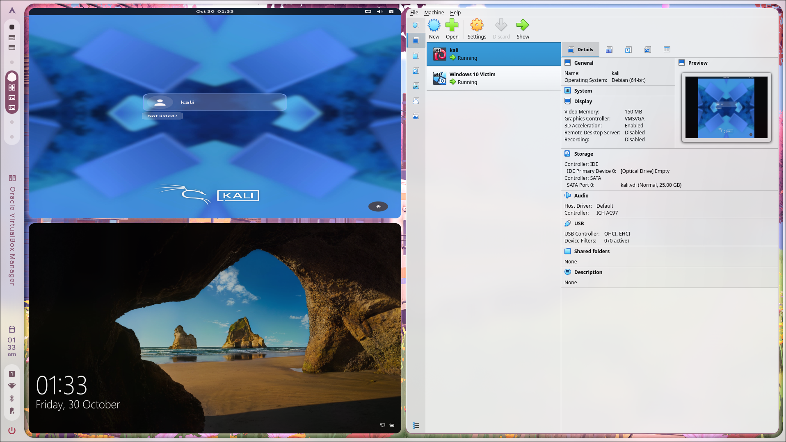
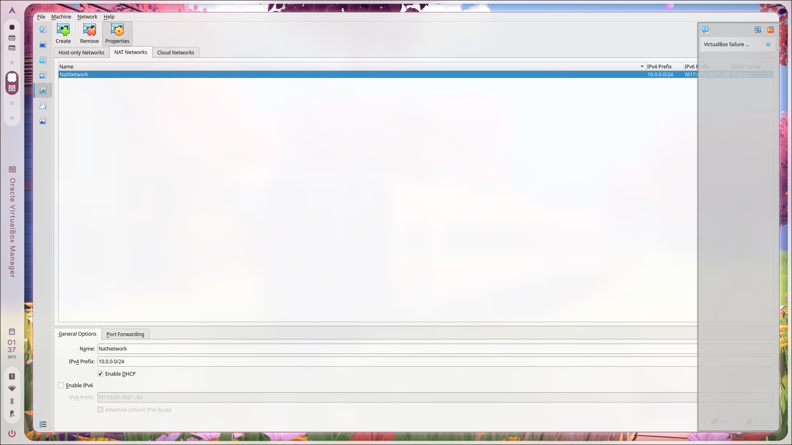
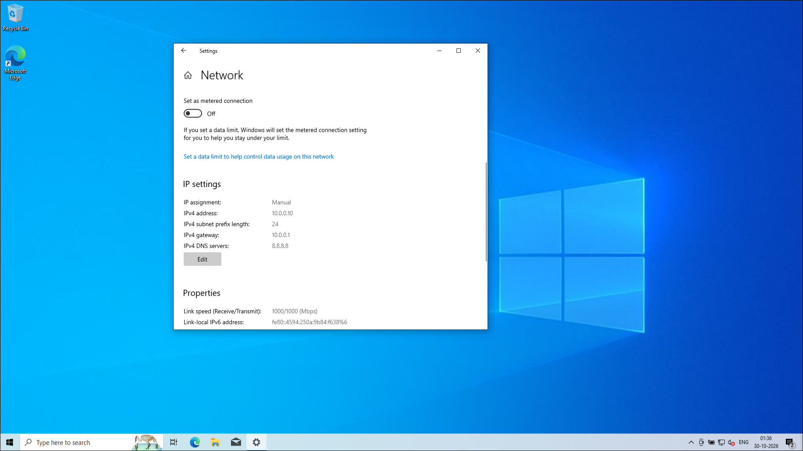
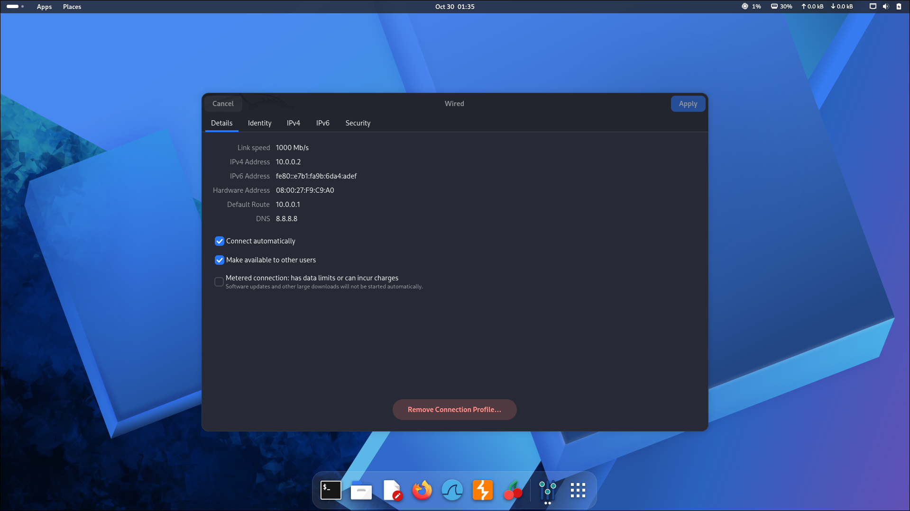

# NetworkWalks — Week 01: Cybersecurity Lab Setup

A virtual cybersecurity lab built with **Oracle VirtualBox**, **Kali Linux**, and **Windows 10**. The lab uses a dedicated VirtualBox NAT Network so the virtual machines can communicate with each other and access external networks through NAT.

> **Purpose:** Build a controlled environment for learning networking, Linux administration, security testing, and defensive analysis. Only test systems you own or have explicit permission to assess.

## Lab at a Glance

- **Hypervisor:** Oracle VirtualBox
- **Security/testing VM:** Kali Linux
- **Target VM:** Windows 10
- **Virtual network:** `NatNetwork`
- **IPv4 subnet:** `10.0.0.0/24`
- **Default gateway:** `10.0.0.1`
- **DNS server:** `8.8.8.8`
- **VirtualBox DHCP:** Enabled in the NAT Network configuration

## Network Configuration

| Machine / Component | IPv4 address | Subnet mask / prefix | Gateway | DNS |
|---|---|---|---|---|
| VirtualBox NAT Network | `10.0.0.0/24` | `/24` | `10.0.0.1` | — |
| Kali Linux | `10.0.0.2` | `255.255.255.0` (`/24`) | `10.0.0.1` | `8.8.8.8` |
| Windows 10 Victim | `10.0.0.10` | `255.255.255.0` (`/24`) | `10.0.0.1` | `8.8.8.8` |

**Note:** The VirtualBox NAT Network has DHCP enabled in the screenshot. The Windows and Kali screenshots show manually configured IPv4 settings. If you assign static addresses, ensure they do not conflict with DHCP leases; consider reserving or excluding those addresses in your lab plan.

## Lab Overview

The VirtualBox Manager shows two virtual machines configured for the lab: Kali Linux and Windows 10 Victim.



## VirtualBox NAT Network

The network is named `NatNetwork` and uses the `10.0.0.0/24` IPv4 prefix. DHCP is enabled and IPv6 is disabled in the shown configuration.



## Windows 10 Network Settings

Windows 10 is configured with the following IPv4 settings:

- **IP address:** `10.0.0.10`
- **Prefix length:** `24`
- **Default gateway:** `10.0.0.1`
- **DNS server:** `8.8.8.8`



## Kali Linux Network Settings

Kali Linux is configured with the following IPv4 settings:

- **IP address:** `10.0.0.2`
- **Subnet:** `255.255.255.0` (`/24`)
- **Default route:** `10.0.0.1`
- **DNS server:** `8.8.8.8`



## Setup Summary

1. Install Oracle VirtualBox on the host machine.
2. Import or create the Kali Linux and Windows 10 virtual machines.
3. In VirtualBox **Network Manager → NAT Networks**, create a network named `NatNetwork`.
4. Set the IPv4 network prefix to `10.0.0.0/24`. Enable DHCP if required by your setup.
5. Open each VM's **Settings → Network** and attach its network adapter to the `NatNetwork` NAT Network.
6. Configure the guest IPv4 settings as listed above, making sure static IPs do not overlap with DHCP-assigned addresses.
7. Start both VMs and verify addressing, gateway reachability, and DNS.

## Verification

Run these checks from each guest where appropriate.

### On Kali Linux

```bash
ip -br address
ip route
cat /etc/resolv.conf
ping -c 4 10.0.0.1
ping -c 4 10.0.0.10
ping -c 4 8.8.8.8
getent hosts example.com
```

### On Windows 10 (PowerShell)

```powershell
ipconfig /all
ping 10.0.0.1
ping 10.0.0.2
ping 8.8.8.8
nslookup example.com
```

If guest-to-guest ping fails, check that both VMs are attached to the same NAT Network and that the guest firewall allows ICMP echo requests. A successful ping is a useful connectivity check, but it is not a complete security validation.

## Learning Outcomes

- Creating and configuring a VirtualBox NAT Network.
- Understanding IPv4 addresses, CIDR notation, subnet masks, gateways, and DNS.
- Connecting multiple guest operating systems to the same virtual network.
- Troubleshooting VM connectivity and guest firewall rules.
- Building a repeatable environment for authorized cybersecurity exercises.

## Safety and Ethical Use

Use this lab only for educational purposes and authorized testing. Keep vulnerable or target machines inside your controlled lab network, and do not scan or attack third-party systems without explicit permission. Take VM snapshots before making major changes so you can restore a known-good state.

## Repository Structure

```text
.
├── README.md
└── assets/
    ├── lab-overview.png
    ├── virtualbox-nat-network.png
    ├── windows-10-network-settings.png
    └── kali-linux-network-settings.png
```

## References

- [Oracle VirtualBox](https://www.virtualbox.org/)
- [Kali Linux — Get Kali](https://www.kali.org/get-kali/)
- [Microsoft — Windows networking](https://learn.microsoft.com/en-us/windows-server/networking/)
